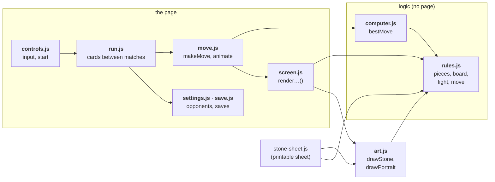
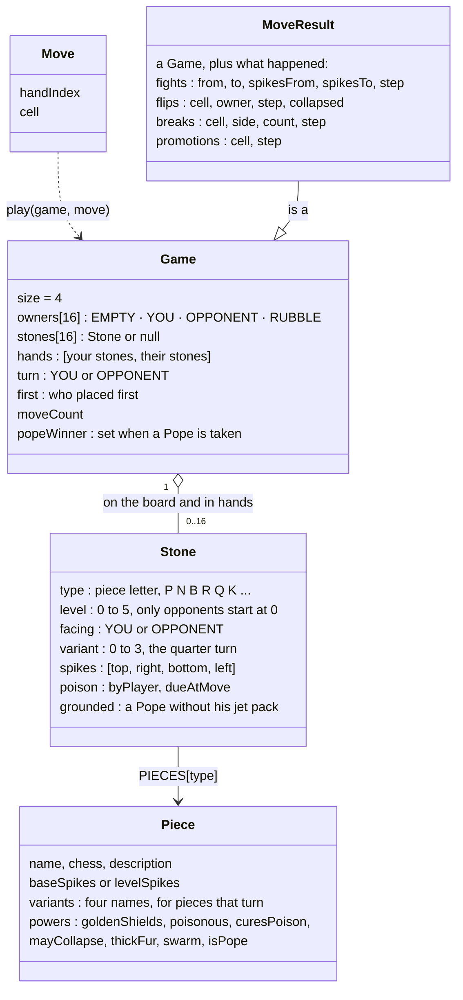
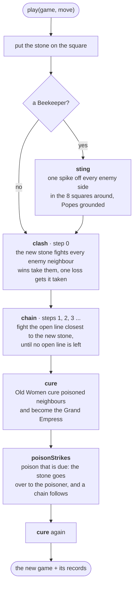
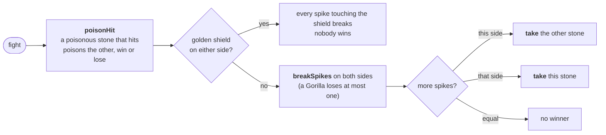
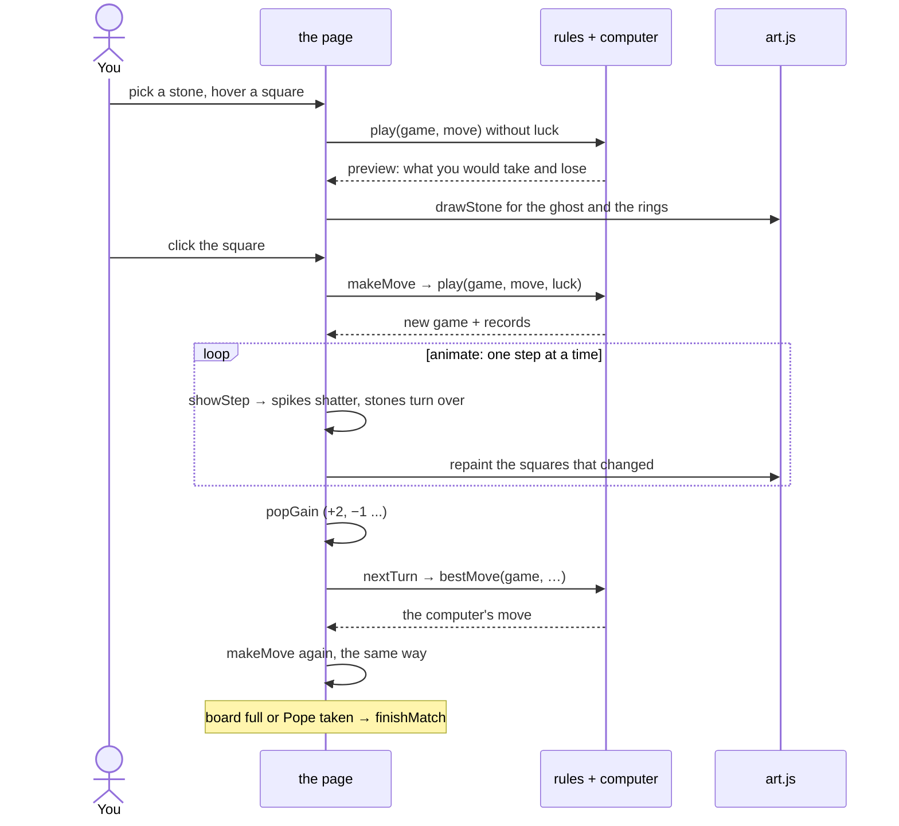
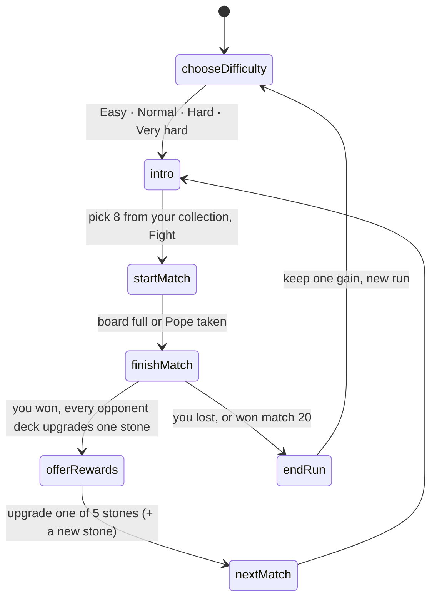

# Rook-like: how the code works

Rook-like is a roguelike of spiked chess stones. You and the computer take turns placing stones on a 4 × 4 board. Facing spikes fight, the winner takes the other stone, and one move can set off a chain of fights. A run is twenty matches against opponents who grow stronger with every win, and the last one is the boss.

The page is [`index.html`](index.html) (layout and rules text) with [`style.css`](style.css) and nine small scripts in [`src/`](src/), loaded in this order. They share one global scope, so a later file can use everything from an earlier one. The diagrams below use the function names from the code, so you can search for any box.

| File | Lines | What it holds |
|---|---|---|
| [`src/rules.js`](src/rules.js) | 454 | the pieces, stones, the board, one fight, one move. Pure logic, never touches the page |
| [`src/computer.js`](src/computer.js) | 117 | the computer player |
| [`src/art.js`](src/art.js) | 240 | every stone and portrait as an SVG string (120 lines are drawing data) |
| [`src/settings.js`](src/settings.js) | 130 | board size, run length, difficulties, the opponents and their decks |
| [`src/save.js`](src/save.js) | 120 | progress and settings in localStorage |
| [`src/screen.js`](src/screen.js) | 255 | the state of a match and the `render…()` functions |
| [`src/move.js`](src/move.js) | 202 | how a move plays out on screen, step by step |
| [`src/run.js`](src/run.js) | 289 | the cards between matches, from difficulty to the end of a run |
| [`src/controls.js`](src/controls.js) | 109 | the rules panel, mouse, touch and keys, and the start |

## How the files fit together



| Part | What it knows | Never does |
|---|---|---|
| **rules + computer** | the pieces, the board, one fight, one move, the computer player | touch the page |
| **art** | how every stone, spike, shield and portrait looks | know the rules |
| **the page** | what is on screen, how a move plays out, the run, saving | decide who wins a fight |

Naming: `render…()` updates the page, `draw…()` returns an SVG string. The rules use the words of the rules: a move is a **clash**, then a **chain**, and stones get **taken**.

## The data



Stones in hands, saves and opponents are written as short **codes**: piece letter, level, and for a turned piece its direction. `N2` is Sir Gallops at level 2, `P1>` a pawn turned to point right. `fromCode(code, facing)` turns a code into a Stone.

The squares are numbered row by row:

```
 0  1  2  3
 4  5  6  7
 8  9 10 11
12 13 14 15
```

## One move: `play(game, move, luck)`

`play` never changes the game it gets. It returns a new game plus a record of everything that happened, step by step, so the page can replay it.



### One fight: `fight(game, cell, side, neighbour, step)`

Two stones meet across one line. The spikes facing each other break off one for one, and a spike that hits is used up, so the winner always spends at least one: 2 against 1 ends 1 against 0.



`take` turns a stone over to the other colour, unless it is the king or a flying Pope. A Pope that is taken ends the match. Prince Joey has a 1 in 3 chance to collapse into rubble instead.

### The chain


Every fight uses up at least one spike, so the chain always ends.

## The computer player: `bestMove(game, thinkingTimeMs, random, maxDepth)`


`score` rates a position for the player to move, with the same order of tiebreaks as `winnerOf`:

| What | Worth |
|---|---|
| taking the Pope | 1 000 000 |
| each point ahead | 2 000 |
| each spike ahead | 2 (at most 640 in total, so one point always counts more) |
| having placed first | 1 |

The difficulty sets two things: `maxDepth`, how many moves ahead the computer may look, and how strong its stones are.

| Difficulty | Looks ahead | Opponent stones start at | After each of your wins, every deck upgrades one stone |
|---|---|---|---|
| Easy | 2 moves | level 0 | tinies first, then everything else, one level at a time |
| Normal | as far as it can | level 0 | tinies, knights, bishops and rooks, then everything else, one level at a time |
| Hard | 2 moves | level 1 | any stone, at random |
| Very hard | as far as it can | level 1 | any stone, at random |

"As far as it can" means one second of thinking (1.6 for the boss). Near the end of a match that reaches the very last move. A level 0 stone has one spike fewer on every spiked side, so a level 0 tiny has none.

## A turn on screen



While a move plays out the board shows `replay.owners`, the colours as they are at that step, and `shownStone` keeps spikes whole until the step in which they break. When the last step is over the page draws the real game again.

## A run



- **Opponent decks** (`newDecks`, `upgradeOne`, `upgradeAllDecks` in `settings.js`): every opponent keeps one deck for the whole run, starting at the difficulty's level. After each match you win, every deck upgrades one stone, so they all grow, even the ones you are not facing. The boss starts with 6 extra upgrades. 
- **Your collection** (`run.collection`, `deckFrom`, `renderCollection` in `run.js`): every stone you own this run, at every level you have had it. Before each match you pick 8 of them as your deck.
- **Rewards** (`offerRewards`): after a win you upgrade one of five random stones from your deck by one level. The upgraded stone takes its place in the deck and the old one stays in the collection. If the opponent played a stone (piece and turn) that you do not own, you also get one of those, at level 1.
- **The end of a run** (`endRun`): keep one gain, an upgrade or a new stone, in your collection for good.
- **Who places first** (`firstFor`): you in odd matches, the opponent in even ones, the boss always.
- **Winning a match** (`winnerOf`): taking the Pope, else most points (stones), else most spikes left, else whoever placed first.
- **Saves** (`loadSave`, `store`) keep your starting hand, records and the run in localStorage. Older saves are converted when they load.

## Checking a change

The code is checked by behaviour, not by tests in the repo:

- `node stone-sheet.js` prints every stone's rating and writes `stones.html`. Its output should not change unless you meant to change a stone.
- For rule changes, play a few seeded games in node with `src/rules.js` and `src/computer.js` (see how `stone-sheet.js` loads them) and compare the move records before and after.
