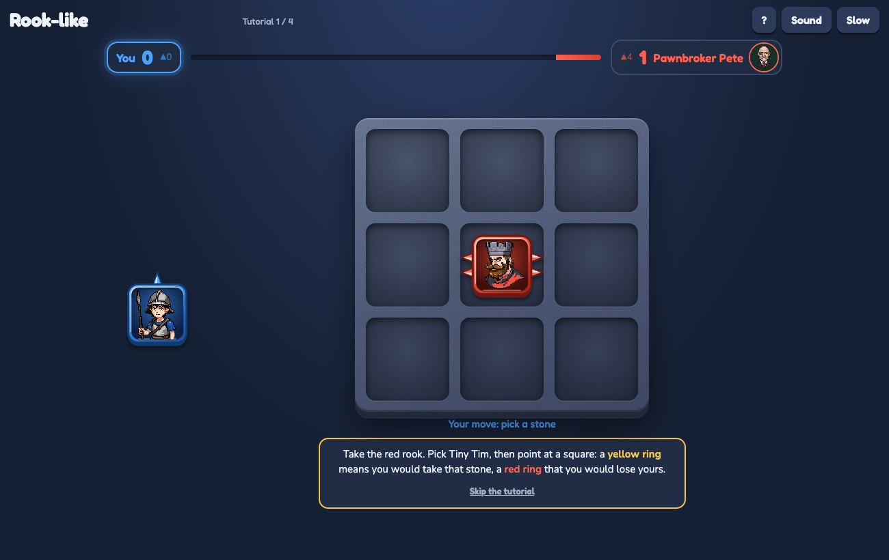
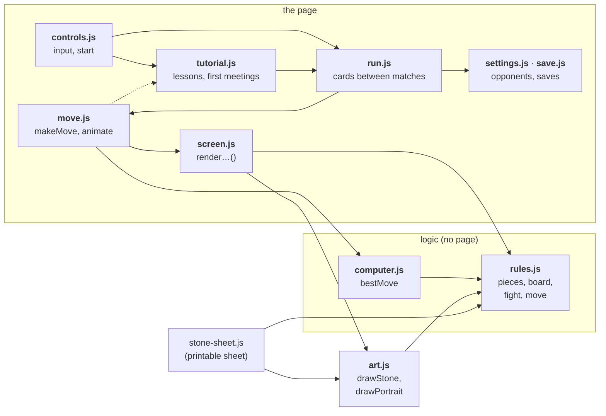
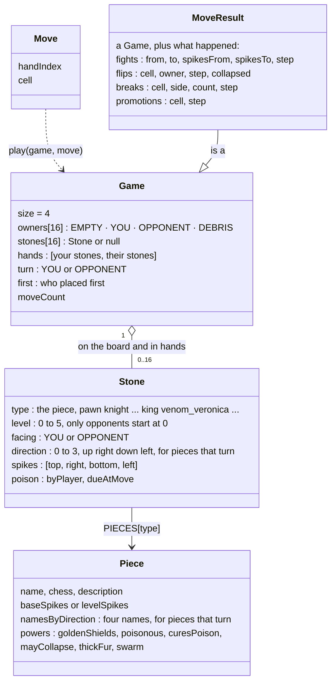
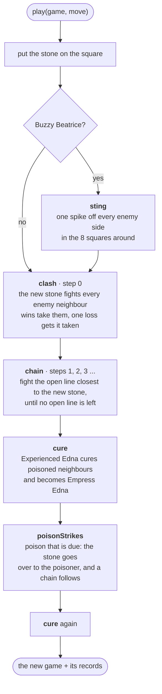
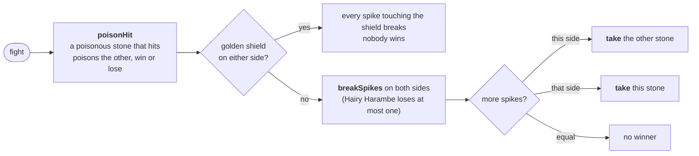
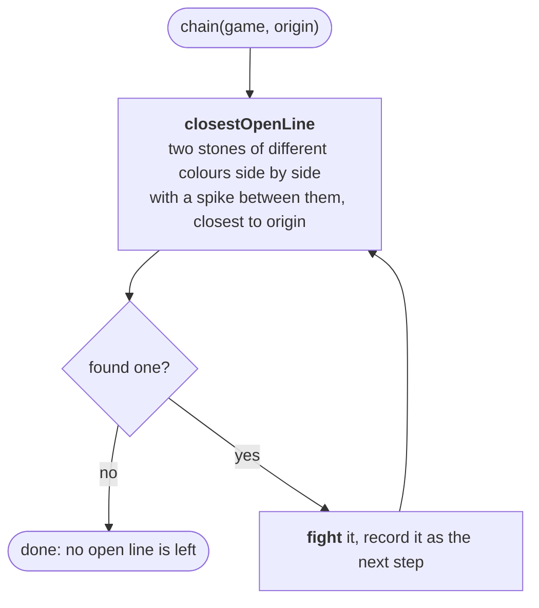
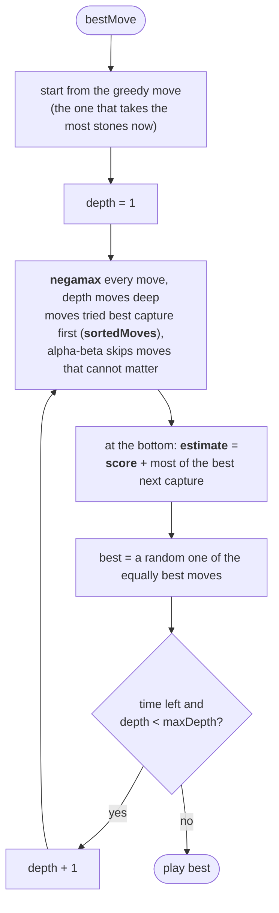
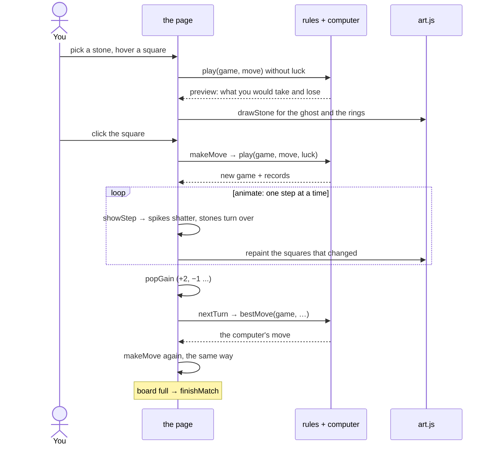
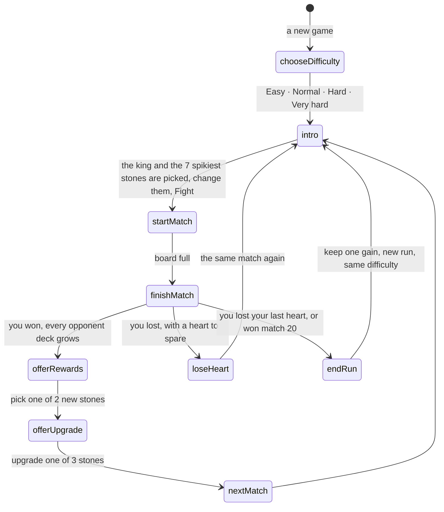

# Rook-like: how the code works

### ▶ [Play Rook-like in your browser](https://louisvandenbruwaene.github.io/rook-like/)

No install, no account: open the link and play. Pick a stone, then a square on the board. A short tutorial starts on its own.

[](https://louisvandenbruwaene.github.io/rook-like/)

Rook-like is a roguelike of spiked chess stones. You and the computer take turns placing stones on a 4 × 4 board. Facing spikes fight, the winner takes the other stone, and one move can set off a chain of fights. A run is twenty matches against opponents who grow stronger with every win, and the last one is the boss. A lost match costs a heart and is played again.

The page is [`index.html`](index.html) (layout and rules text) with [`style.css`](style.css) and eleven small scripts in [`src/`](src/), loaded in this order. They share one global scope, so a later file can use everything from an earlier one. The diagrams below use the function names from the code, so you can search for any box.

| File | Lines | What it holds |
|---|---|---|
| [`src/rules.js`](src/rules.js) | 484 | the pieces, stones and stone codes, the board, one fight, one move. Pure logic, never touches the page |
| [`src/computer.js`](src/computer.js) | 132 | the computer player |
| [`src/art.js`](src/art.js) | 153 | every stone and portrait: the stones show the pixel-art PNGs in [`art/stones/`](art/stones/), the opponents the pixel-art PNGs in [`art/opponents/`](art/opponents/) |
| [`src/settings.js`](src/settings.js) | 253 | board size, run length, difficulties and their hearts, the opponents and their decks |
| [`src/save.js`](src/save.js) | 239 | progress and settings in localStorage |
| [`src/screen.js`](src/screen.js) | 314 | the state of a match, a move playing out, and the `render…()` functions |
| [`src/sound.js`](src/sound.js) | 146 | a tiny synth, no audio files: every sound of the game, and the Sound button |
| [`src/move.js`](src/move.js) | 282 | how a move plays out on screen, step by step, seen and heard |
| [`src/run.js`](src/run.js) | 620 | the cards between matches: the run match by match, hearts, your deck, rewards, the end |
| [`src/tutorial.js`](src/tutorial.js) | 275 | the coach line under the board: the four practice boards, and a word and a demo board for each rare stone you meet |
| [`src/controls.js`](src/controls.js) | 129 | the rules panel, mouse, touch and keys, and the start |

Every file starts with a header that says what it builds on and lists its sections (`Contents: …`), and every section starts with a `/* ---------- name ---------- */` line, so a search for `----------` lists them all.

## Where to find things

| To change… | Look at |
|---|---|
| a piece's spikes, name or power | `PIECES` in `rules.js` |
| what a power does in a fight | `fight`, `breakSpikes`, `poisonHit`, `sting`, `cure`, `take` in `rules.js` |
| how a stone looks | its PNG in `art/stones/` (64 x 64, made with PixelLab), drawn by `drawCharacter` in `art.js` |
| which detail of a stone shows its team's colour | `DETAILS` in `art/team_colours.py`; run it (needs Pillow and numpy) after changing a portrait to remake the copies `<piece>-blue.png` and `<piece>-red.png` next to each original |
| how an opponent portrait looks | its PNG in `art/opponents/` (64 x 64, made with PixelLab, named after `portrait` in `OPPONENTS`), shown by `drawPortrait` in `art.js` |
| run length, deck size, thinking time | the top of `settings.js` |
| difficulties | `DIFFICULTIES` in `settings.js` (the card text is made from it by `difficultyTile` in `run.js`) |
| an opponent or their deck | `OPPONENTS` and `BOSS` in `settings.js` |
| how strong the computer plays | `bestMove` and the values at the top of `computer.js` |
| what a square on the board shows | `squareClasses` and `squareContents` in `screen.js`, styled in `style.css` |
| the timing of a move on screen | the `…_MS` constants and `animate` in `move.js` |
| rewards and the end of a run | `offerRewards`, `offerUpgrade`, `takeGift`, `takeIntoDeckIfStronger`, `loseHeart`, `endRun` in `run.js` |
| how something sounds, and the volume | `sounds` and the settings at the top of `sound.js`; `stepSounds` in `move.js` picks them for each step of a move |
| which stones go into your deck before a match | `deckLike` (the deck you last fought with, kept in `save.lastDeck`) and `chooseDeck` in `run.js` |
| what is saved | `newSave` in `save.js`; add a `fromVersion…` step when the shape changes |
| keys, mouse and touch | the input section of `controls.js` |
| the rules text | `#rules-template` in `index.html` |
| the tutorial's practice boards | `LESSONS` in `tutorial.js` |
| a rare stone's demo board on the card before a match | `DEMOS` in `tutorial.js` (worked out by `play`, so it always follows the rules) |
| the move named on the loss card | `worstMove` in `run.js`, played again by `replayMove` in `move.js` |

## Shared state

The files share one global scope. These are the only variables that change while the game runs:

| Variable | File | What it is |
|---|---|---|
| `save`, `settings` | `save.js` | your progress, slow motion and sound off, written back by `store()` |
| `audio` | `sound.js` | the AudioContext, made at the first sound |
| `game`, `opponent` | `screen.js` | the match being played and who you face, set by `startMatch` and `makeMove` |
| `ui` | `screen.js` | your selected stone, the hovered square, the last move, whether input waits |
| `history` | `screen.js` | every move of the match, for the loss card |
| `replay` | `screen.js` | how far a move has played out on screen, set by `startReplay` and `endReplay` |
| `tutorial` | `tutorial.js` | the lesson on the board, and the match to go back to, while the tutorial runs |
| `timers` | `move.js` | every pending timeout, so giving up can cancel a move |
| `search` | `computer.js` | the computer's clock while it thinks |

## How the files fit together



| Part | What it knows | Never does |
|---|---|---|
| **rules + computer** | the pieces, the board, one fight, one move, the computer player | touch the page |
| **art** | how every stone, spike, shield and portrait looks | know the rules |
| **the page** | what is on screen, how a move plays out, the run, saving | decide who wins a fight |

Naming: `render…()` updates the page, `draw…()` returns an SVG string. The rules use the words of the rules: a move is a **clash**, then a **chain**, and stones get **taken**.

## The data



Stones in hands, saves and opponents are written as **codes**: the piece, the level, and for a turned piece its direction, all in full. `knight_level_2` is Neigh Nigel at level 2, `pawn_level_1_right` a pawn turned to point right, `king_level_1` the king. Saves from before version 5 used short codes (`N2`, `P1>`) and are converted by `fromVersion4` in `save.js`. `fromCode(code, facing)` turns a code into a Stone.

The squares are numbered row by row:

```
 0  1  2  3
 4  5  6  7
 8  9 10 11
12 13 14 15
```

## One move: `play(game, move, luck)`

`play` never changes the game it gets. It returns a new game plus a record of everything that happened, step by step, so the page can replay it.



### One fight: `fight(game, cell, side, neighbour, step)`

Two stones meet across one line. The spikes facing each other break off one for one, and a spike that hits is used up, so the winner always spends at least one: 2 against 1 ends 1 against 0.



`take` turns a stone over to the other colour, unless it is the king. Brittle Bernard has a 1 in 3 chance to collapse into debris instead.

### The chain



Every fight uses up at least one spike, so the chain always ends.

## The computer player: `bestMove(game, thinkingTimeMs, random, maxDepth)`



`score` rates a position for the player to move, with the same order of tiebreaks as `winnerOf`:

| What | Worth |
|---|---|
| each point ahead | 2 000 |
| each spike ahead | 2 (at most 640 in total, so one point always counts more) |
| having placed first | 1 |

The difficulty sets how many moves ahead the computer may look and how fast its stones grow. Every opponent starts at level 0; after each of your wins every deck gains `growth` levels (1.5 is 1, 2, 1, 2, ...), one stone one level at a time, so the opponents pull further ahead the longer the run goes. The boss misses the first `bossBehind` of those upgrades: with two queens and placing first it needs no more.

| Difficulty | Looks ahead | Levels a win | Boss misses | Hearts | Which stones grow first |
|---|---|---|---|---|---|
| Easy | 2 moves | 1 | 0 | 3 | tinies, then everything else, one level at a time |
| Normal | as far as it can | 1.5 | 4 | 3 | tinies, knights, bishops and rooks, then everything else |
| Hard | 2 moves | 2 | 12 | 2 | any stone, at random |
| Very hard | as far as it can | 2.25 | 17 | 1 | any stone, at random |

"As far as it can" means one second of thinking (1.6 for the boss). Near the end of a match that reaches the very last move. A level 0 stone has one spike fewer on every spiked side, so a level 0 tiny has none.

## A turn on screen



While a move plays out the board shows `replay.owners`, the colours as they are at that step, and `shownStone` keeps spikes whole until the step in which they break. When the last step is over the page draws the real game again.

## A run



- **Opponent decks** (`newDecks`, `upgradeOne`, `upgradeAllDecks` in `settings.js`): every opponent keeps one deck for the whole run, starting at the difficulty's level. After each match you win, every deck gains the difficulty's growth in levels, so they all grow, even the ones you are not facing. The boss misses the first `bossBehind` upgrades.
- **The difficulty** (`save.difficulty`, `beginRun` in `run.js`) is chosen once for the whole game. Losing a run starts a new run of the same game, at the same difficulty. **New game** in the rules panel (`startNewGame`) starts over from the starter stones and asks again; records stay.
- **Your last stone** is selected for you when it is your turn (`nextTurn` in `move.js`).
- **Your collection** (`run.collection`, `spikiestDeck`, `deckFrom`, `renderCollection` in `run.js`): every stone you own this run, at every level you have had it, never twice the same. Before each match the king and the 7 with the most spikes are picked as your deck (`spikiestDeck`) and you may change them, at most one king and one queen (`sameLimitedPiece`); other stones may come at several levels, never twice the same code.
- **Hearts** (`run.lives`, `loseHeart`): a run starts with the difficulty's `lives`. A lost match costs one and is played again, against the same deck; losing with one heart left ends the run.
- **Rewards** (`offerRewards`, `offerUpgrade`): after a win you first pick one of two new stones (`GIFT_CHOICES`), then upgrade one of three random stones from your deck by one level. The upgraded stone takes its place in the deck and the old one stays in the collection, except a queen, who is replaced. A pawn or knight turn grows to at most one level more than the number of its turns you own, so one horse reaches level 2 and a third level needs a second horse. The new stones are ones (piece and turn) you do not own: ones the opponent played, or any missing pawn or knight turn (`TURNED_STONES`), at the opponent's level or one below your best of that piece.
- **The end of a run** (`endRun`): keep one stone you do not own yet in your collection for good. A queen replaces the one you had.
- **Who places first** (`firstFor`): you in odd matches, the opponent in even ones, the boss always.
- **Winning a match** (`winnerOf`): most points (stones), else most spikes left, else whoever placed first.
- **Saves** (`loadSave`, `store`) keep your starting hand, records and the run in localStorage. Older saves are converted when they load.

## Checking a change

The code is checked by behaviour, not by tests in the repo:

- `node stone-sheet.js` prints every stone's rating (in the order of `PIECES`) and writes `stones.html`. Its output should not change unless you meant to change a stone.
- For rule changes, play a few seeded games in node with `src/rules.js` and `src/computer.js` (see how `stone-sheet.js` loads them) and compare the move records before and after. A refactor should leave them identical.
- Formatting is Prettier with the settings in [`.prettierrc.json`](.prettierrc.json) (120 wide, single quotes), for the scripts and `style.css` alike.

## Naming

- Stones and pieces are written out in full: `king_level_1`, `pawn_level_1_right`, never `K1` or `P1>`.
- Debris is the piece `debris` and the owner `DEBRIS`.
- A stone's `direction` (0 to 3: up, right, down, left) is where a piece that turns points; `facing` is whose side it is drawn for.
- Every timing and size in `move.js` and `computer.js` is a named constant at the top of its section.
- CSS variables say what they are: `--stone-size`, `--board-size`, `--time-scale`.
